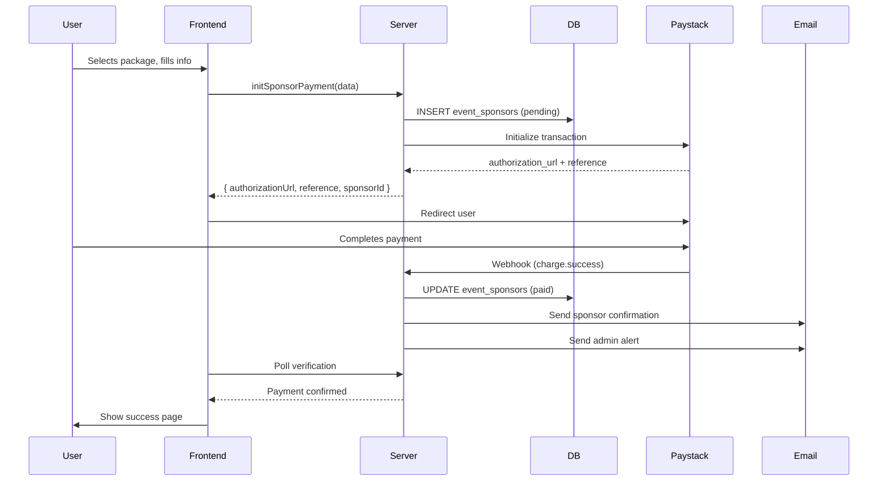

# Event Sponsor & Participant System — Execution Plan

> **Status:** Pending Approval  
> **Date:** 31 May 2026  
> **Project:** Gaspo Studios — gaspo-studios

---

## 1. Overview & Scope

### 1.1 Current State
- `public.events` has `sponsor_packages` (JSONB), `sponsorship_enabled`, and `registration_open` fields
- `public.event_registrations` handles basic free registrations only
- Payment integration (Paystack) exists in `payment.ts` but the event sponsor flow uses a **mock checkout** on the frontend (`$eventId.tsx` line 232: `Paystack Checkout (Mock)`)
- Admin Events dashboard (`/admin/events`) has three tabs: **Events**, **Registrations**, **Sponsors** — but the Sponsors tab has no backend
- No email notification system exists
- `sponsor-portal.tsx` in admin reads from the `events` table directly (no dedicated sponsor records)

### 1.2 Target State
Two distinct flows on the public event page:

| Flow | Entry Point | Steps | End State |
|---|---|---|---|
| **Sponsor** | "Become a Sponsor" button → selects package | Package → Confirmation → Paystack → Receipt + Email | Record in `event_sponsors` table |
| **Participant** | "Register Now — It's Free" form | Fill form → Submit | Record in `event_registrations` table (enhanced) |

Admin receives:
- Email for every completed sponsor payment
- Dashboard visibility into all sponsors and participants
- Check-in management for participants
- Sponsor activity tracking

---

## 2. Database Changes

### 2.1 New Table: `event_sponsors`

```sql
CREATE TABLE public.event_sponsors (
    id              TEXT PRIMARY KEY DEFAULT gen_random_uuid()::text,
    event_id        TEXT NOT NULL REFERENCES public.events(id) ON DELETE CASCADE,
    company_name    TEXT NOT NULL,
    contact_name    TEXT NOT NULL,
    contact_email   TEXT NOT NULL,
    contact_phone   TEXT NOT NULL,
    package_id      TEXT NOT NULL,           -- matches sponsor_packages[].id
    package_name    TEXT NOT NULL,
    package_price   NUMERIC(12,2) NOT NULL,
    currency        TEXT NOT NULL DEFAULT 'NGN',
    payment_ref     TEXT,                    -- Paystack transaction reference
    payment_status  TEXT NOT NULL DEFAULT 'pending'
                    CHECK (payment_status IN ('pending','paid','failed','refunded')),
    paid_at         TIMESTAMPTZ,
    status          TEXT NOT NULL DEFAULT 'active'
                    CHECK (status IN ('active','cancelled','completed')),
    admin_notes     TEXT,
    created_at      TIMESTAMPTZ DEFAULT now(),
    updated_at      TIMESTAMPTZ DEFAULT now()
);
```

### 2.2 Enhance: `event_registrations`

Add columns for participant type and linked sponsor:

```sql
ALTER TABLE public.event_registrations
  ADD COLUMN registration_type TEXT NOT NULL DEFAULT 'participant'
      CHECK (registration_type IN ('participant','sponsor_guest','speaker','staff','vip')),
  ADD COLUMN linked_sponsor_id TEXT REFERENCES public.event_sponsors(id) ON DELETE SET NULL,
  ADD COLUMN event_interest TEXT[] DEFAULT '{}'::text[],
  ADD COLUMN confirmation_sent BOOLEAN DEFAULT false;
```

### 2.3 New Table: `email_log`

```sql
CREATE TABLE public.email_log (
    id              UUID PRIMARY KEY DEFAULT gen_random_uuid(),
    recipient       TEXT NOT NULL,
    subject         TEXT NOT NULL,
    body            TEXT,
    type            TEXT NOT NULL
                    CHECK (type IN ('sponsor_confirmation','participant_confirmation',
                                    'admin_sponsor_alert','admin_payment_alert','check_in')),
    reference_id    TEXT,                    -- links to event_sponsors.id or event_registrations.id
    status          TEXT NOT NULL DEFAULT 'sent'
                    CHECK (status IN ('sent','failed','bounced')),
    sent_at         TIMESTAMPTZ DEFAULT now()
);
```

### 2.4 Migration File

**Create:** `supabase/migrations/004_event_sponsors.sql`

---

## 3. Server Functions (New & Enhanced)

### 3.1 Sponsor Functions

| Function | Method | Auth | Purpose |
|---|---|---|---|
| `initSponsorPayment` | POST | Public | Create sponsor record (pending), call Paystack, return auth URL |
| `verifySponsorPayment` | GET | Public | Verify Paystack transaction, update sponsor to paid, send emails |
| `fetchEventSponsors` | GET | Auth | Admin: list sponsors for an event |
| `updateSponsorStatus` | POST | Auth (admin) | Admin: cancel/complete a sponsor |

**`initSponsorPayment`** schema:
```
Input:  { eventId, companyName, contactName, contactEmail, contactPhone, packageId, packageName, packagePrice }
Output: { authorizationUrl, reference, sponsorId }
```

### 3.2 Participant Functions

| Function | Method | Auth | Purpose |
|---|---|---|---|
| `registerForEvent` | POST | Public | Create registration record, send confirmation email |
| `fetchEventRegistrations` | GET | Auth | Admin: list registrations (already exists, enhance) |
| `checkInAttendee` | POST | Auth (admin) | Toggle check-in status (already exists) |

**`registerForEvent`** schema:
```
Input:  { eventId, fullName, email, phone, company, jobTitle, country, city, linkedin, eventInterest, howHeard }
Output: { registrationId, confirmationSent }
```

### 3.3 Payment Functions

| Function | Method | Auth | Purpose |
|---|---|---|---|
| `initPaystackTransaction` | POST | Public | Already exists — works for both sponsor & general payments |
| `verifyPaystackWebhook` | POST | Public (webhook) | Handle Paystack webhook callback for payment verification |

### 3.4 Email Functions

| Function | Method | Auth | Purpose |
|---|---|---|---|
| `sendSponsorConfirmation` | Internal | — | Send email to sponsor after payment verified |
| `sendParticipantConfirmation` | Internal | — | Send email to participant after registration |
| `sendAdminPaymentAlert` | Internal | — | Send email to admin on new sponsor payment |
| `sendCheckInConfirmation` | Internal | — | Send email on check-in |

---

## 4. Frontend Changes

### 4.1 Public Event Page (`src/routes/events/$eventId.tsx`)

**Current issue:** The sponsor flow uses a mock checkout UI. Replace with real flow.

**Changes:**

1. **Sponsor Flow (new state machine):**
   ```
   [Event Page] → [Select Package] → [Sponsor Info Form] → [Confirmation Page] → [Paystack Redirect] → [Success Page]
   ```

   - Add `sponsorStep` state: `"select" | "info" | "confirm" | "payment" | "success"`
   - **Select Package:** User clicks "Become a Sponsor" → scrolls to sponsorship packages → clicks a package card
   - **Info Form:** Collects company name, contact name, email, phone, optional message
   - **Confirmation Page:** Shows package details + entered info + total amount. "Proceed to Payment" button
   - **Payment:** Calls `initSponsorPayment()` → redirects to Paystack authorization URL
   - **Success:** After Paystack callback, show success with transaction reference. Email sent automatically by server

2. **Participant Flow (enhance existing):**
   - Keep existing registration form at `#register`
   - Add `eventInterest` checkboxes (Topics, Networking, Sponsorship, Speaking, Volunteering, General)
   - Add "I'm representing a sponsor" checkbox → shows sponsor company dropdown
   - After submission, call `registerForEvent()` → show success message
   - Add countdown timers for registration deadline

### 4.2 Confirmation Page (`src/routes/events/confirmation.tsx`)

New route: `/events/confirmation`

- Receives `type=sponsor|participant` and `reference` (for sponsors) or `registrationId` (for participants) via query params
- Fetches confirmation details from server
- Shows:
  - Success icon + "Payment Confirmed" or "Registration Confirmed"
  - Summary of what was purchased/registered
  - Transaction reference (sponsors)
  - "Add to Calendar" button
  - "Back to Event" link

### 4.3 Admin Dashboard

#### Events Tab (`src/routes/admin/events/index.tsx`)

Enhance the existing three tabs:

1. **Events tab** (existing — works)
2. **Registrations tab** (enhance):
   - Add columns: `Registration Type`, `Linked Sponsor`, `Event Interest`, `Check-in Status`
   - Add filter: by type (Participant / Sponsor Guest / Speaker / VIP)
   - Add export CSV button
   - Add "Send Confirmation Email" action for individual registrations
3. **Sponsors tab** (new backend):
   - Table: Company, Contact, Package, Amount, Payment Status, Actions
   - Actions: View Details, Mark Complete, Cancel, Send Receipt
   - Filter: by payment status

#### Sponsor Detail Panel

When clicking a sponsor row:
- Full sponsor info (company, contact details)
- Payment info (reference, status, date)
- Linked participants (if any sponsor guests registered)
- Admin notes field (editable)
- Activity log (status changes, emails sent)

### 4.4 Check-in Page (`src/routes/admin/events/$eventId/check-in.tsx`)

Enhance existing:
- QR code scanner integration
- Manual lookup by name/email
- Sponsor guest vs regular participant badges
- Real-time counter (checked in / total registered)

---

## 5. Email System

### 5.1 Templates

All emails use a simple HTML template with Gaspo Studios branding.

**Sponsor Confirmation:**
```
Subject: Payment Confirmed — [Package Name] Sponsorship for [Event Title]

Dear [Contact Name],

Thank you for sponsoring [Event Title] as a [Package Name] Sponsor.

Transaction Reference: [Ref]
Amount Paid: ₦[Amount]
Event Date: [Date]
Venue: [Venue]

Your sponsorship package includes:
[List benefits from package]

We'll be in touch with event details closer to the date.

— Gaspo Studios Team
```

**Participant Confirmation:**
```
Subject: You're Registered — [Event Title]

Dear [Full Name],

You're now registered for [Event Title] on [Date] at [Venue].

Please bring this confirmation email (or show it on your phone) at check-in.

Add to Calendar | View Event Details

— Gaspo Studios Team
```

**Admin Payment Alert:**
```
Subject: 🔔 New Sponsor Payment — [Company Name] • ₦[Amount]

Payment Details:
- Event: [Event Title]
- Sponsor: [Company Name]
- Package: [Package Name]
- Amount: ₦[Amount]
- Reference: [Ref]
- Date: [Date]

View in Admin Dashboard: [Link]
```

### 5.2 Implementation

- Use Supabase Edge Functions or a lightweight SMTP integration
- For initial launch: store in `email_log` table, use `nodemailer` or Resend SDK in server functions
- All emails logged in `email_log` for audit trail

---

## 6. Payment Flow (Paystack)

### 6.1 Sponsor Payment Sequence



### 6.2 Paystack Webhook

Create `/api/paystack-webhook` endpoint:
- Verify webhook signature using Paystack secret key
- On `charge.success`: find sponsor by reference, update to paid, trigger emails
- On `charge.failed`: update sponsor status to failed
- Store raw webhook payload in `email_log` for debugging

---

## 7. File Manifest (What to Create / Modify)

### New Files
| File | Purpose |
|---|---|
| `supabase/migrations/004_event_sponsors.sql` | DB schema changes |
| `src/routes/events/confirmation.tsx` | Post-payment/registration confirmation page |
| `src/routes/events/sponsor-checkout.tsx` | Sponsor info + confirmation page |
| `src/lib/email.server.ts` | Email sending utility (nodemailer/SMTP) |
| `src/lib/actions/sponsors.ts` | Sponsor server functions |

### Modified Files
| File | Changes |
|---|---|
| `src/routes/events/$eventId.tsx` | Real sponsor flow (replace mock), enhanced registration form |
| `src/routes/admin/events/index.tsx` | Sponsor tab backend + enhanced registrations tab |
| `src/routes/admin/events/$eventId/check-in.tsx` | Enhanced check-in with sponsor badges |
| `src/routes/admin/sponsor-portal.tsx` | Real data from `event_sponsors` table |
| `src/lib/actions/events.ts` | Add `registerForEvent`, enhance `fetchEventRegistrations` |
| `src/lib/actions/payment.ts` | Add `initSponsorPayment`, `verifySponsorPayment`, webhook handler |
| `src/routes/admin.tsx` | Add sponsor count to sidebar badge (optional) |
| `src/server.ts` | Add Paystack webhook route |

---

## 8. Execution Order (Phases)

### Phase 1 — Database & Server Functions
1. Create migration `004_event_sponsors.sql` and run it
2. Add `event_sponsors` table + alter `event_registrations`
3. Create `src/lib/actions/sponsors.ts` with CRUD functions
4. Enhance `payment.ts` with `initSponsorPayment` + `verifySponsorPayment`

### Phase 2 — Sponsor Flow (Public)
5. Update `$eventId.tsx` with real sponsor flow state machine
6. Create sponsor info form component
7. Create confirmation/review step component
8. Integrate real Paystack redirect (replace mock)
9. Create `confirmation.tsx` page

### Phase 3 — Participant Flow
10. Enhance registration form with event interest & sponsor affiliation
11. Add `registerForEvent` server function
12. Add participant confirmation email

### Phase 4 — Admin Dashboard
13. Update `admin/events/index.tsx` Sponsors tab with real data
14. Add sponsor detail view (modal or expandable row)
15. Enhance registrations tab with new columns & filters
16. Add check-in enhancements
17. Update `sponsor-portal.tsx` with real data

### Phase 5 — Email System
18. Create `src/lib/email.server.ts` with Resend/SMTP integration
19. Add email templates for all notification types
20. Wire emails into payment verification & registration flows
21. Add `email_log` table migration

### Phase 6 — Polish
22. Add CSV export for registrations & sponsors
23. Add sponsor activity log on admin
24. Add real-time check-in counter
25. QR code generation for participants
26. End-to-end testing with real Paystack test keys

---

## 9. Risks & Dependencies

| Risk | Mitigation |
|---|---|
| Paystack webhook not configured in dev | Use mock webhook + manual verification for local testing |
| Email delivery failures | Log all to `email_log`, add retry logic, show admin warnings |
| Sponsor pays but record not found | Webhook handler: look up by reference, create record if missing |
| Concurrent registrations hitting capacity limits | Use database-level locking / `registration_count` atomic increment |
| Supabase RLS blocking public writes | Use service role key for public-facing server functions |

---

## 10. Approval Checklist

- [ ] Database schema changes reviewed
- [ ] Payment flow sequence approved
- [ ] Email template designs reviewed
- [ ] Admin dashboard layout approved
- [ ] Execution phases & order approved

---

**Prepared by:** GitHub Copilot  
**For:** Gaspo Studios  
**File:** `docs/EventSponsorParticipant.MD`
